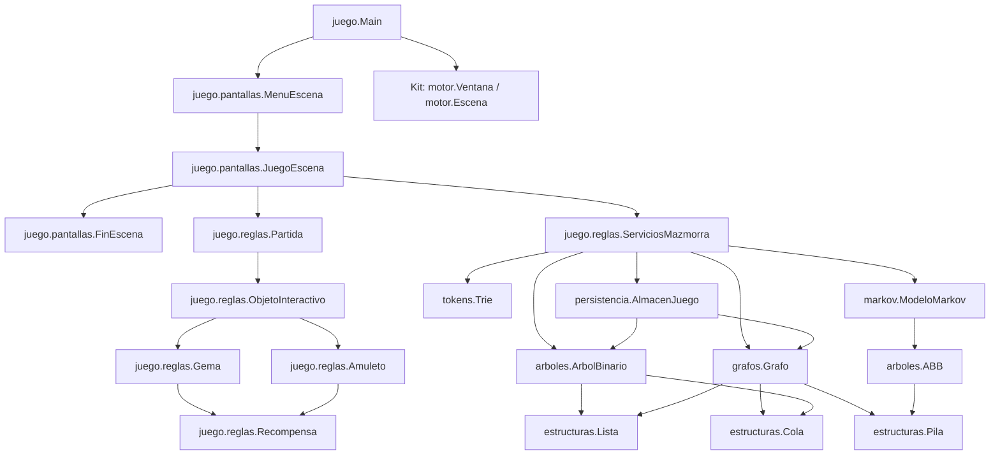

# Diagrama de clases y paquetes

Los paquetes del kit `motor`, `contratos`, `ui` y `verificador` se mantienen sin cambios. `estructuras` conserva las interfaces originales y agrega implementaciones enlazadas propias.
